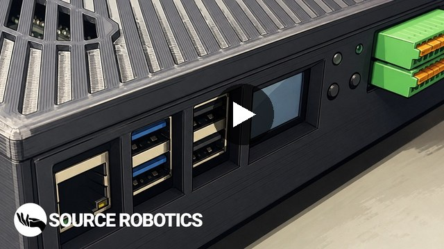

  

<h1 align="center">Robot Control Box</h1>

  <b>The controller of the PAR6 robot arm, with open-source firmware, software and enclosure.</b> 
  It runs the robot on a Raspberry Pi 5 with a real-time kernel, and connects the arm, the E-stops, PCs and PLCs.

  <a href="https://docs.google.com/forms/d/e/1FAIpQLSfJVBVM5K6rCrFRtpijmTBLeePUdGDxUlWBni1VqBrAZwRCwg/viewform"><b>Join the beta</b></a>&nbsp;&nbsp;·&nbsp;&nbsp;
  <a href="https://docs.source-robotics.com/par6/latest/rcb/"><b>Documentation</b></a>&nbsp;&nbsp;·&nbsp;&nbsp;
  <a href="https://youtu.be/qAzd839ixuw"><b>Assembly video</b></a>&nbsp;&nbsp;·&nbsp;&nbsp;
  <a href="https://github.com/Source-Robotics/RCB-Runtime"><b>Runtime</b></a>&nbsp;&nbsp;·&nbsp;&nbsp;
  <a href="https://discord.com/invite/prjUvjmGpZ"><b>Discord</b></a>

  
  
  
  

| **Raspberry Pi 5** | **Real-time Linux** | **3 + 3** | **2 E-stop channels** | **CAN bus** |
|:-:|:-:|:-:|:-:|:-:|
| runs the robot, no external PC | Ubuntu 24.04.2, kernel 6.8.4-rt11 | isolated inputs and outputs | cross-checked on PCB v2 | to the drives in the arm and the gripper |

## Project overview

<table>
  <tr>
    <td width="55%" valign="middle">
      RCB, the Robot Control Box, is the brain and interface hub of the PAR6 robot. It runs the real-time control
      algorithms, connects to the robot arm (motors, sensors), interfaces with external devices (PCs, PLCs,
      sensors), handles the safety systems and provides the user interface and programming environment.
        
      There is no need for an external PC: the box uses a Raspberry Pi to control your robotic arm.
        
      <a href="https://youtu.be/qAzd839ixuw"><b>&#9654;&#xFE0E;&nbsp; Watch the RCB assembly video</b></a>
    </td>
    <td width="45%" valign="middle">
      
    </td>
  </tr>
</table>

The box runs [RCB-Runtime](https://github.com/Source-Robotics/RCB-Runtime) on its Raspberry Pi 5: the real-time
control loop, the CAN communication with the motor drives, the command executor, the dashboard, the display and
buttons on the front panel, and the mainboard's I/O.

## Beta

> [!NOTE]
> This is a beta release: the instructions, the code and the 3D print files may change in the future and are not
> yet final. If you want to be part of the beta testing, fill in the
> [beta sign-up form](https://docs.google.com/forms/d/e/1FAIpQLSfJVBVM5K6rCrFRtpijmTBLeePUdGDxUlWBni1VqBrAZwRCwg/viewform).

By building and using this system, you acknowledge that it is still under active development and may contain
errors, incomplete features, or design issues. You are doing so entirely at your own risk and responsibility.

This project may require troubleshooting, modifications, and technical knowledge. Proceed only if you are
comfortable working with electronics, mechanical systems, and software in a development-stage environment.

**Beta feedback.** Since this project is currently in beta, feedback is highly appreciated. If you find any mistakes,
bugs, or unclear parts, please report them, including issues in the documentation, the BOM and assembly
documentation, the source code, and the STL and other 3D print files. Please
[open an issue](https://github.com/Source-Robotics/RCB-Robot-Control-Box/issues), send us a message on
[Discord](https://discord.com/invite/prjUvjmGpZ), or contact us via email
([Getting help](https://docs.source-robotics.com/par6/latest/support/)) with as much detail as possible, so we can
fix it quickly.

## Start here

| I want to | Go to |
|---|---|
| **Join the beta** | [beta sign-up form](https://docs.google.com/forms/d/e/1FAIpQLSfJVBVM5K6rCrFRtpijmTBLeePUdGDxUlWBni1VqBrAZwRCwg/viewform) · the mainboard and the Raspberry Pi connector PCB come in the [PAR6 Beta Kit](https://source-robotics.com/products/par6-beta-kit), for approved beta testers |
| **Build my own** | [BOM](BOM/) · [print files](STEP%20files/) ([print table](Assembly%20manual/Print_table.md)) · [assembly video](https://youtu.be/qAzd839ixuw) |
| **Connect the arm and wire it** | [robot cable](Assembly%20manual/Building_cables.md) ([video](https://youtu.be/QlNfWAga1l0)) · [E-stop wiring](https://docs.source-robotics.com/par6/latest/rcb/02-safety/emergency-stop/) · [pin map of the connector panel](https://github.com/Source-Robotics/RCB-Runtime/blob/v1.1.1/docs/pin_map.md) |
| **Set up the software** | [Setting up the software](https://docs.source-robotics.com/par6/latest/rcb/05-software-setup/), from the operating system image to the system check · [RCB-Runtime](https://github.com/Source-Robotics/RCB-Runtime) |
| **Program the robot** | [Programming Guide](https://docs.source-robotics.com/par6/latest/programming/) · [RCB-Runtime](https://github.com/Source-Robotics/RCB-Runtime) (with the Python client and the dashboard) |
| **Update the mainboard firmware** | [RCB motherboard firmware](RCB%20motherboard%20firmware/) (PlatformIO, uploaded over ST-Link) · [ST-LINK USB driver for Windows](en.stsw-link009.zip) |
| **Use it with the arm** | [PAR6-Collaborative-Robot-Arm](https://github.com/Source-Robotics/PAR6-Collaborative-Robot-Arm) · [PAR6 manual](https://docs.source-robotics.com/par6/) |

## In this repository

| Folder | What is in it |
|---|---|
| [`BOM`](BOM/) | the bill of materials for one box, with shop links and reference images, and the parts of the PAR6 robot cable |
| [`STEP files`](STEP%20files/) | the enclosure and the printed parts as STEP: the bottom, the ribbed top, the lid, the socket cover, the Pi bottom, the Pi fan holder, the resistor holder |
| [`Assembly manual`](Assembly%20manual/) | building the PAR6 robot cable, the print table (25 % infill, PETG) |
| [`RCB motherboard firmware`](RCB%20motherboard%20firmware/) | the mainboard firmware (PlatformIO, STM32F103) |
| [`Photos`](Photos/) | the photo of the boxes |

Beside the folders: [`en.stsw-link009.zip`](en.stsw-link009.zip), the ST-LINK USB driver for Windows (STSW-LINK009)
for uploading the mainboard firmware; [`Buttons stuff.png`](Buttons%20stuff.png), the wire colours of the power button
and its LED; [`Wires_2 - Copy.png`](Wires_2%20-%20Copy.png), the CAN H and CAN L, GND and 24 V wires from the arm's
GX16 socket to the mainboard.

There is no release yet: while the box is in beta, the files on the main branch are the latest. The runtime, the
operating system image and the drive firmware that go with them are on the manual's
[Downloads and files](https://docs.source-robotics.com/par6/latest/par6/cad-files/) page.

## Community

Ask in [Discussions](https://github.com/orgs/Source-Robotics/discussions), chat on
[Discord](https://discord.com/invite/prjUvjmGpZ), report a bug in
[Issues](https://github.com/Source-Robotics/RCB-Robot-Control-Box/issues), and follow Source Robotics:

## Safety, liability and disclaimer

This project includes experimental software, hardware designs, and assembly documentation that are still under development and may contain bugs, errors, or incomplete features. By using, building, or modifying this project, you acknowledge that:

* You use this project entirely at your own risk
* You are solely responsible for safe assembly, testing, and operation
* No guarantee is made regarding correctness, safety, or reliability
* The authors are not responsible for any damage, injury, or loss resulting from the use or misuse of this project
* Hardware performance and safety depend on user assembly, component quality, calibration, and handling, which cannot be guaranteed
* This project is provided “as is.” If you choose to build a device yourself using these files, designs, or instructions, you do so without any warranties or guarantees, including regarding safety, reliability, or suitability for any particular purpose.

> [!WARNING]
> THIS PROJECT INVOLVES LETHAL VOLTAGES AND OTHER SERIOUS HAZARDS THAT CAN CAUSE SEVERE INJURY. YOU MUST READ THE FULL [SAFETY WARNING AND DISCLAIMER DOCUMENT](SAFETY_WARNING_AND_DISCLAIMER.md)  BEFORE USING ANY PROJECT FILES. BY PROCEEDING, YOU ACKNOWLEDGE AND ACCEPT ALL RISKS AND AGREE TO USE THIS PROJECT ENTIRELY AT YOUR OWN RESPONSIBILITY.

## Licensing

The hardware (the STEP files, the BOM and the assembly manual) is under the [CERN Open Hardware Licence Version 2 - Strongly Reciprocal](LICENSE) (CERN-OHL-S-2.0). The firmware in `RCB motherboard firmware` is under [GPL-3.0](RCB%20motherboard%20firmware/LICENSE), and the libraries in its `lib` folder keep their own licences. Until 4 November 2026 the repository's main licence was MIT.

## Versions

There is no release yet. What the beta is, which mainboard you have, and what works with it: [VERSIONS.md](VERSIONS.md).
